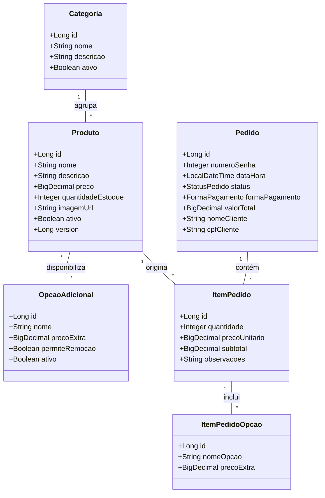

# 🤖 AGENT.md - Guia de Engenharia e Instruções para Desenvolvimento com IA

> **Projeto:** Sistema PDV Web Core - Antunes Lanches  
> **Arquitetura Base:** MVC com Decomposição Rígida do Model (Aula 08) + Spring Boot 3.x  
> **Status do Repositório:** Configuração Inicial / Desenvolvimento Ativo  
> **Público-Alvo:** Agentes de IA (Antigravity, Cursor, Copilot, Gemini) e Desenvolvedores

---

## 1. Visão Geral e Propósito do Sistema

O **Sistema PDV Web Core** é uma plataforma moderna, modular e responsiva de **Ponto de Venda (PDV) e Autoatendimento** para a lanchonete **Antunes Lanches** (e estabelecimentos de alimentação em geral).

A aplicação opera tanto como um **Totem de Autoatendimento Touch (estilo McDonald's)** quanto em **Dispositivos Móveis e Desktop**, integrando a jornada completa de consumo:
1. **Cliente / Autoatendimento:** Navegação por categorias, customização de lanches ("Monte seu lanche" / adicionais), carrinho dinâmico, identificação opcional, pagamento (PIX / Cartão) e emissão de senha sequencial diária.
2. **Cozinha / KDS (Kitchen Display System):** Painel operacional em tempo real com workflow de status (`RECEBIDO` $\rightarrow$ `EM_PREPARO` $\rightarrow$ `PRONTO` $\rightarrow$ `ENTREGUE`).
3. **Salão / Painel de Senhas:** Exibição em tela/TV das senhas prontas e em preparo.
4. **Gestão / Administrativo:** CRUD de produtos e categorias, controle de estoque com concorrência otimista e relatórios de faturamento.

---

## 2. Stack Tecnológica e Requisitos Técnicos

| Camada / Função | Tecnologia | Detalhes / Versão |
|---|---|---|
| **Linguagem** | Java 17+ | Records, Pattern Matching, Text Blocks |
| **Framework Backend** | Spring Boot 3.x | Spring MVC, Spring Data JPA, Spring Validation |
| **Persistência / ORM** | Jakarta Persistence (JPA) + Hibernate | Mapeamento relacional estrito, `@Version` otimista |
| **Banco de Dados (Dev)** | H2 Database | Em memória com console habilitado (`/h2-console`) |
| **Banco de Dados (Prod)**| PostgreSQL 15+ | Perfil `prod` configurado via variáveis de ambiente |
| **Front-End (Views)** | HTML5 + CSS3 Moderno + Vanilla JS | Layout responsivo (Flexbox/Grid), CSS Custom Properties, Thymeleaf |
| **Comunicação Reativa**| Spring Events (`Observer`) | `ApplicationEventPublisher` e `@EventListener` |
| **Gerenciador de Build**| Apache Maven | `pom.xml` padronizado |
| **Tratamento de Erros** | RFC 7807 (`ProblemDetail`) | `@ControllerAdvice` global |

---

## 3. Matriz Arquitetural e Decomposição do Model (Aula 08)

O projeto adota o padrão **MVC (Model-View-Controller)** com decomposição estrita do **Model** em 3 subcamadas independentes:

```mermaid
graph TD
    subgraph View ["Camada View (Interface Web Responsiva)"]
        V1["Totem Autoatendimento / Cliente"]
        V2["Painel Cozinha (KDS)"]
        V3["Painel de Senhas (TV)"]
        V4["Painel Administrativo"]
    end

    subgraph Controller ["Camada Controller (Spring MVC / REST)"]
        C1["TotemController / PedidoController"]
        C2["KdsController / PainelController"]
        C3["AdminProdutoController"]
    end

    subgraph Model ["Camada Model (Subcamadas Especializadas)"]
        SERV["<b>Service (Negócio)</b><br/>Regras, Transações (@Transactional), Eventos"]
        REPO["<b>Repository (Persistência)</b><br/>Spring Data JPA (DIP)"]
        ENT["<b>Entity (Domínio)</b><br/>Estado Puro + Mapeamento JPA"]
    end

    View -->|Requisição HTTP / Form / DTO| Controller
    Controller -->|Invoca Caso de Uso| SERV
    SERV -->|Valida e opera sobre| ENT
    SERV -->|Persiste / Consulta via| REPO
    REPO -->|Mapeia de/para o BD| ENT
    SERV -->|Publica Eventos (Observer)| Controller
    Controller -->|Renderiza Template ou Retorna DTO| View
```

### 3.1 Tabela de Responsabilidades por Camada

| Camada | O QUE DEVE FAZER | O QUE NUNCA DEVE FAZER (ANTI-PATTERNS) |
|---|---|---|
| **View (Thymeleaf / UI)** | Renderizar interface responsiva, capturar toques/cliques, exibir mensagens ao usuário. | ❌ Consultar banco de dados.<br/>❌ Calcular totais, descontos ou aplicar regras de negócio no JS/HTML. |
| **Controller** | Mapear rotas HTTP, validar sintaxe dos DTOs de entrada (`@Valid`), delegar aos Services e selecionar a View/DTO de resposta. | ❌ Conter código SQL, HQL ou `EntityManager`.<br/>❌ Implementar regras de negócio (*God Controller*). |
| **Service (Model)** | Centralizar toda regra de negócio, transações (`@Transactional`), validação de estoque e publicação de eventos (`publishEvent`). | ❌ Importar pacotes visuais/HTML.<br/>❌ Depender de DTOs específicos de apresentação. |
| **Repository (Model)** | Executar CRUD e consultas via Spring Data JPA (`JpaRepository`). Isolar dialeto SQL. | ❌ Conter validações de regras de negócio.<br/>❌ Disparar notificações ou acoplar serviços. |
| **Entity (Model)** | Representar dados e relacionamentos relacionais puros, manter integridade de atributos e getters/setters. | ❌ Adicionar chamadas de persistência em si mesma (`salvar()`, `deletar()`).<br/>❌ Fazer chamadas a Services ou Repositories. |

---

## 4. Padrões de Projeto Mandatórios

### 4.1 Padrão Observer (GoF / Spring Events)
Para evitar acoplamento direto entre o encerramento do pedido e os módulos secundários (KDS, impressão de senha, e-mail/notificação), utilize `ApplicationEventPublisher`:
- **Evento:** `PedidoCriadoEvent`, `PedidoStatusAlteradoEvent`.
- **Publisher:** `PedidoService`.
- **Listeners:**
  - `KdsEventListener`: Atualiza a fila da cozinha.
  - `ComprovanteEventListener`: Gera e registra a senha sequencial.
  - `EstoqueEventListener`: Realiza reconciliação quando aplicável.

### 4.2 Concorrência Otimista (`@Version`)
Na entidade `Produto`, o campo `@Version private Long version;` deve ser utilizado para prevenir condições de corrida (*race conditions*) em compras simultâneas do último item em estoque.

### 4.3 Monolito Modular e Tipagem Segura
- Sempre utilizar `BigDecimal` para representar valores monetários (`preco`, `subtotal`, `valorTotal`). **Proibido usar `float` ou `double` para moeda.**
- Sempre utilizar Enums para estados e modalidades (`StatusPedido`, `FormaPagamento`, `TipoOpcao`).

---

## 5. Estrutura Canônica de Diretórios e Pacotes

Todo código implementado deve seguir rigorosamente a árvore de diretórios abaixo:

```text
projeto-pdv/
├── .github/                       # Workflows e automações do repositório
├── src/
│   ├── main/
│   │   ├── java/com/restaurante/pdv/
│   │   │   ├── PdvApplication.java                # Classe principal @SpringBootApplication
│   │   │   ├── config/                           # Configurações globais (WebConfig, OpenAPI, etc.)
│   │   │   ├── controller/                       # Controllers Spring MVC e REST
│   │   │   │   ├── TotemController.java           # Fluxo de autoatendimento
│   │   │   │   ├── PedidoController.java          # API / Operações de pedidos
│   │   │   │   ├── KdsController.java             # Cozinha e expedição
│   │   │   │   ├── PainelSenhasController.java    # Display do salão
│   │   │   │   └── AdminProdutoController.java    # Gestão de cardápio e estoque
│   │   │   ├── dto/                              # Records / DTOs de Request e Response
│   │   │   │   ├── request/                      # DTOs de entrada anotados com @Valid
│   │   │   │   └── response/                     # DTOs de saída higienizados
│   │   │   ├── event/                            # Padrão Observer (Spring Events)
│   │   │   │   ├── PedidoCriadoEvent.java
│   │   │   │   ├── PedidoStatusAlteradoEvent.java
│   │   │   │   └── listener/                     # @Component com métodos @EventListener
│   │   │   ├── exception/                        # Tratamento global de erros
│   │   │   │   ├── GlobalExceptionHandler.java   # @ControllerAdvice / ProblemDetail
│   │   │   │   ├── NegocioException.java
│   │   │   │   └── RecursoNaoEncontradoException.java
│   │   │   └── model/                            # Subcamadas do Model (Aula 08)
│   │   │       ├── entity/                       # Entidades JPA (@Entity)
│   │   │       │   ├── Categoria.java
│   │   │       │   ├── Produto.java
│   │   │       │   ├── OpcaoAdicional.java       # Insumos / Adicionais / Remoções
│   │   │       │   ├── Pedido.java
│   │   │       │   ├── ItemPedido.java
│   │   │       │   ├── ItemPedidoOpcao.java
│   │   │       │   ├── StatusPedido.java         # Enum
│   │   │       │   └── FormaPagamento.java       # Enum
│   │   │       ├── repository/                   # Repositórios Spring Data JPA
│   │   │       │   ├── CategoriaRepository.java
│   │   │       │   ├── ProdutoRepository.java
│   │   │       │   ├── PedidoRepository.java
│   │   │       │   └── OpcaoAdicionalRepository.java
│   │   │       └── service/                      # Casos de Uso e Regras de Negócio
│   │   │           ├── ProdutoService.java
│   │   │           ├── PedidoService.java
│   │   │           ├── PagamentoService.java
│   │   │           └── SenhaDiariaService.java
│   │   └── resources/
│   │       ├── application.yml                   # Configurações gerais e profiles
│   │       ├── application-dev.yml               # H2 Database + dev tools
│   │       ├── application-prod.yml              # PostgreSQL
│   │       ├── data.yml / data.sql               # Carga inicial do cardápio Antunes Lanches
│   │       ├── static/                           # CSS moderno, JS puro e imagens
│   │       │   ├── css/                          # styles.css, totem.css, kds.css, admin.css
│   │       │   ├── js/                           # totem.js, kds.js, painel-senhas.js
│   │       │   └── img/                          # Imagens dos lanches e logo
│   │       └── templates/                        # Telas Thymeleaf
│   │           ├── layout/                       # Fragments (header, nav, modal)
│   │           ├── totem/                        # Boas-vindas, cardápio, customização, checkout
│   │           ├── kds/                          # Painel da cozinha em tempo real
│   │           ├── senhas/                       # TV do salão
│   │           └── admin/                        # Gestão de produtos e estoque
│   └── test/
│       └── java/com/restaurante/pdv/
│           ├── model/service/                    # Testes unitários de regras de negócio
│           ├── model/repository/                 # @DataJpaTest de consultas
│           └── controller/                       # @WebMvcTest de rotas e validações
├── pom.xml                                       # Dependências e build Maven
└── README.md                                     # Documentação do projeto
```

---

## 6. Modelo de Domínio (Antunes Lanches)

### 6.1 Diagrama de Entidades



### 6.2 Ciclo de Vida do Pedido (`StatusPedido`)
```
[CARRINHO] ──> [RECEBIDO] ──> [EM_PREPARO] ──> [PRONTO] ──> [ENTREGUE]
                     │
                     └──> [CANCELADO]
```

### 6.3 Regra de Senha Sequencial Diária
- Todo pedido finalizado recebe uma senha inteira diária (ex: `#001`, `#002`, ..., `#999`).
- A numeração reinicia a cada novo dia civil (`LocalDate.now()`).
- O `SenhaDiariaService` deve ser thread-safe (`AtomicInteger` com reset diário ou consulta indexada no banco).

---

## 7. Backlog de Desenvolvimento (Cards do Projeto)

Ao desenvolver novas funcionalidades ou atender prompts do usuário, consulte os cards detalhados em `create_cards.ps1`:

### 7.1 Módulo Back-End
- **CARD-01 (`P0`):** Configuração da Arquitetura MVC, Persistência JPA e Banco de Dados (Branch: `feature/backend-001`).
- **CARD-02 (`P0`):** Modelagem e CRUD de Produtos, Categorias e Insumos.
- **CARD-03 (`P1`):** Motor de Customização de Lanches e Combos (McDonald's Style).
- **CARD-04 (`P0`):** Processamento Transacional de Pedidos e Carrinho de Compras.
- **CARD-05 (`P0`):** Módulo de Pagamentos: Integração PIX (QR Code) e Cartão.
- **CARD-06 (`P1`):** Emissão de Senha Sequencial Diária e Identificação do Cliente.
- **CARD-07 (`P0`):** Implementação do Padrão Observer via Spring `ApplicationEventPublisher`.
- **CARD-08 (`P1`):** API do KDS (Kitchen Display System) e Workflow de Status.
- **CARD-09 (`P2`):** Controle de Estoque com Concorrência Otimista (`@Version`).
- **CARD-10 (`P2`):** API de Relatórios Gerenciais e Fechamento de Vendas.

### 7.2 Módulo Front-End & UI
- **CARD-11 (`P0`):** Design System & Layout Responsivo Base (Antunes Lanches).
- **CARD-12 (`P1`):** Tela de Boas-Vindas e Escolha de Consumo (Totem Touch).
- **CARD-13 (`P0`):** Vitrine de Produtos & Navegação por Categorias do Cardápio.
- **CARD-14 (`P1`):** Modal Interativo de Personalização ("Monte seu Lanche").
- **CARD-15 (`P0`):** Carrinho de Compras Flutuante & Drawer de Resumo.
- **CARD-16 (`P1`):** Tela de Identificação com Teclado Virtual Touch.
- **CARD-17 (`P0`):** Tela de Pagamento Interativo (PIX / Cartão).
- **CARD-18 (`P1`):** Tela de Confirmação do Pedido e Ficha de Senha Digital.
- **CARD-19 (`P0`):** Painel KDS da Cozinha (Display Operacional em Tempo Real).
- **CARD-20 (`P1`):** Painel de Chamada de Senhas para TV do Salão.
- **CARD-21 (`P1`):** Painel Administrativo de Gestão de Cardápio e Estoque.
- **CARD-22 (`P2`):** Dashboard Administrativo de Métricas e Faturamento.

---

## 8. Comandos Úteis de Desenvolvimento

### 8.1 Compilação e Execução
```powershell
# Compilar o projeto e validar dependências
./mvnw clean compile

# Executar suíte de testes unitários e de integração
./mvnw test

# Iniciar a aplicação localmente (perfil dev com H2)
./mvnw spring-boot:run

# Iniciar com perfil específico (ex: produção)
./mvnw spring-boot:run -Dspring-boot.run.profiles=prod

# Gerar pacote executável JAR
./mvnw clean package -DskipTests
```

### 8.2 Endpoints e Rotas Padrão em Desenvolvimento
- **Aplicação Principal:** `http://localhost:8080/`
- **Totem de Autoatendimento:** `http://localhost:8080/totem`
- **Cozinha (KDS):** `http://localhost:8080/kds`
- **Painel de TV (Senhas):** `http://localhost:8080/painel-senhas`
- **Gestão Administrativa:** `http://localhost:8080/admin`
- **Console do H2:** `http://localhost:8080/h2-console`
  - *JDBC URL:* `jdbc:h2:mem:pdvdb`
  - *User:* `sa`
  - *Password:* *(vazio)*

---

## 9. Instruções Específicas para Agentes de IA

Ao ser solicitado a implementar código, corrigir bugs ou estender funcionalidades neste repositório:

1. **Priorize a Separação Estrita de Camadas:**
   - Nunca insira lógica de negócio no `Controller` ou em templates Thymeleaf/JS.
   - Nunca instancie conexões SQL puras; use sempre a camada `Repository` com Spring Data JPA.
   - Use DTOs nos parâmetros e retornos dos controllers para não expor entidades gerenciadas diretamente na View.
2. **Respeite a Integridade Transacional:**
   - Métodos de serviço que alteram múltiplos registros (ex: debitar estoque + criar pedido + registrar itens) **devem** ser anotados com `@Transactional`.
3. **Use o Padrão Observer para Reatividade:**
   - Ao alterar o status de um pedido ou criar um novo pedido, publique o respectivo evento via `ApplicationEventPublisher`. Não invoque serviços de notificação ou websocket diretamente dentro do `PedidoService`.
4. **Validações Consistentes:**
   - Utilize Jakarta Bean Validation (`@NotNull`, `@NotBlank`, `@Positive`, `@Size`) em DTOs e entidades.
   - Lance exceções de negócio customizadas que herdem de `RuntimeException` tratadas pelo `GlobalExceptionHandler`.
5. **Código Limpo e Documentado:**
   - Mantenha comentários em português concisos e precisos.
   - Utilize nomes de variáveis expressivos e tipagem estrita.
   - Não crie classes vazias ou mockadas sem a estrutura completa necessária para a tarefa.
6. **Controle de Branches e Git:**
   - Ao iniciar o trabalho em um card específico, verifique se a branch correspondente está ativa (ex: `feature/backend-001`).
   - Mantenha commits focados e mensagens descritivas seguindo Conventional Commits (`feat:`, `fix:`, `refactor:`, `test:`).

