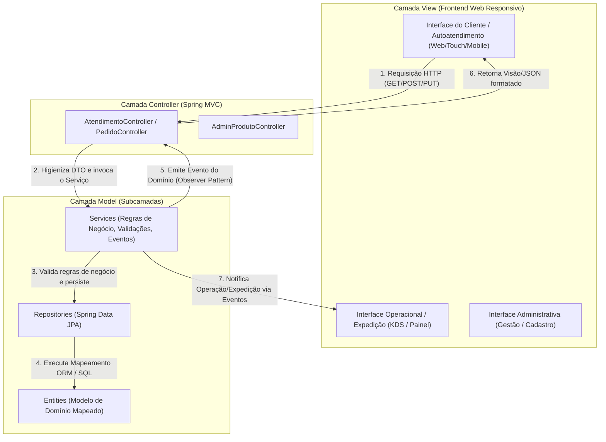
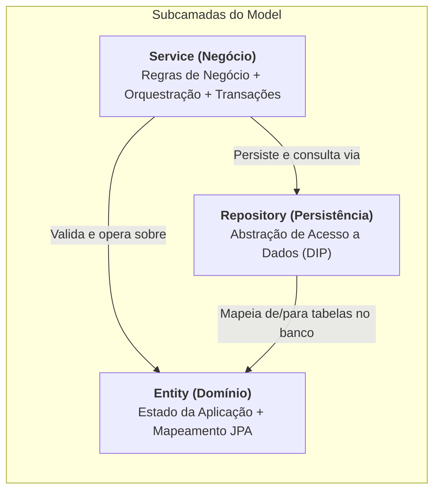
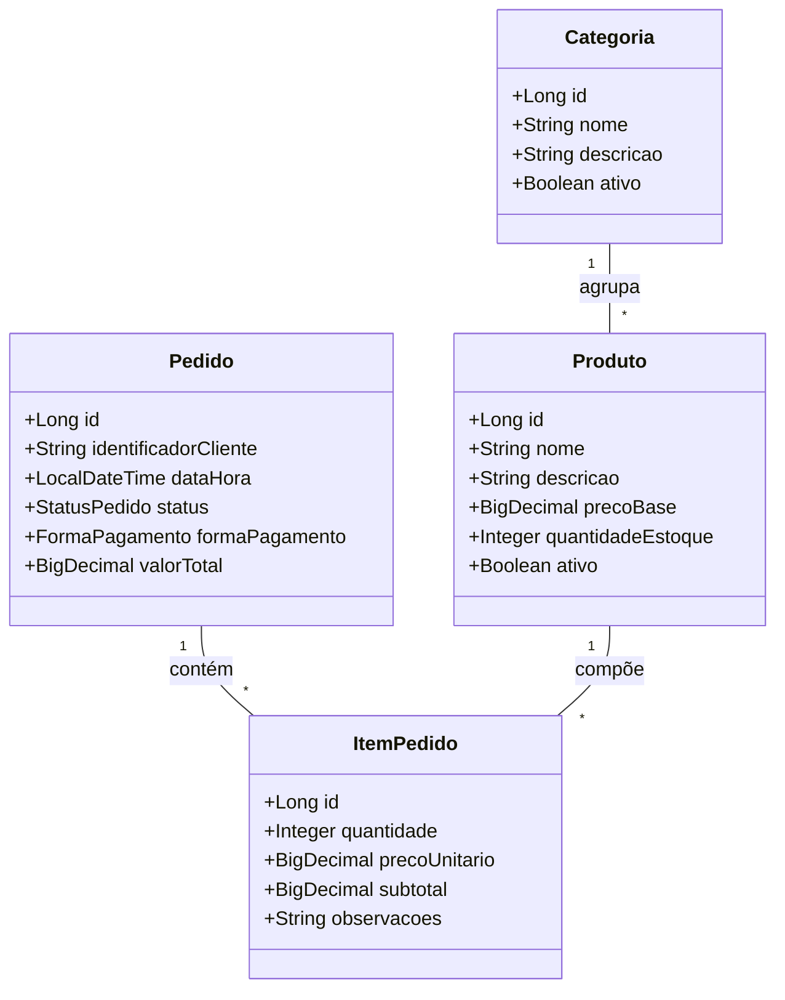
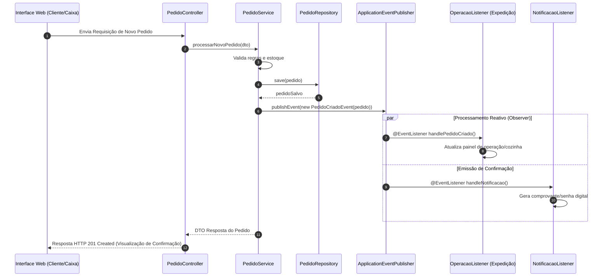

# Especificação Geral de Engenharia do Projeto: Sistema PDV Web Core

---

## 1. Visão Geral e Propósito do Sistema

O **Sistema PDV Web Core** é uma plataforma genérica e extensível de **Ponto de Venda (PDV) e Autoatendimento Web** projetada para estabelecimentos de alimentação e comércio (restaurantes, lanchonetes, cafeterias, pizzerias, etc.).

Como as particularidades do modelo de negócio específico (tipo de cardápio, regras de atendimento, complementos e fluxos operacionais) ainda estão em fase de definição, a arquitetura foi desenhada para ser **altamente configurável e modular**, fundamentada nos princípios de desenvolvimento de software corporativo:

1. **Arquitetura MVC (Model-View-Controller)** com **Spring Boot**.
2. **Decomposição Específica do Model:** Separação rígida em `Entity`, `Service` e `Repository` (conforme conceitos da Aula 08).
3. **Persistência Objeto-Relacional Flexível:** Mapeamento via **JPA / Hibernate** com baixo acoplamento ao SGBD.
4. **Comunicação Reativa por Eventos:** Aplicação do padrão **Observer (GoF)** para integração assíncrona entre o encerramento do pedido, expedição/cozinha e relatórios.

---

## 2. Requisitos de Flexibilidade e Modularidade

O sistema fornece um **núcleo genérico (Core Domain)** capaz de se adaptar a qualquer segmento de restaurante ou alimentação através de configurações de banco de dados e parâmetros de serviço:

| Módulo / Funcionalidade | Estrutura Flexível | Adaptação para o Negócio Futuro |
|---|---|---|
| **Catálogo de Produtos** | Estrutura hierárquica baseada em `Categoria` e `Produto` com opções configuráveis (`ItemOpcao`). | Atende desde fast-foods com combos até restaurantes *à la carte* ou cafeterias. |
| **Personalização de Itens** | Relacionamento 1:N entre `ItemPedido` e `Adicional/Observacao`. | Permite definir se os produtos aceitam adicionais, remoção de ingredientes ou escolhas de tamanho. |
| **Workflow de Status** | Máquina de estados configurável via Enum (`StatusPedido`). | Permite fluxos simples (*Recebido $\rightarrow$ Concluído*) ou complexos (*Recebido $\rightarrow$ Em Preparo $\rightarrow$ Pronto $\rightarrow$ Entregue*). |
| **Formas de Pagamento** | Abstração da interface `PagamentoService`. | Suporta pagamentos por PIX, Cartão (Crédito/Débito), Dinheiro ou integração com gateways terceiros. |
| **Interface de Usuário (View)** | Layout Web Responsivo em HTML5 / CSS3 (Grid e Flexbox) via Thymeleaf. | Funciona em telas Desktop, Tablets, Smartphones ou terminais de autoatendimento touch sem alteração de backend. |

---

## 3. Arquitetura em Camadas (Padrão MVC)

O sistema adota o padrão **MVC**, mantendo o desacoplamento total entre a apresentação visual, o processamento de regras e a persistência dos dados:



---

## 4. Decomposição do Model: Entity, Service e Repository

O **Model** é estruturado estritamente em três subcamadas com responsabilidades isoladas:



### 4.1 Entidade de Domínio (`Entity`)
- Representa o modelo conceitual orientado a objetos e suas anotações Jakarta Persistence (`@Entity`, `@Table`, `@Id`, `@Column`, `@ManyToOne`, `@OneToMany`).
- **Lógica de Estado Puro:** Contém propriedades privadas, getters, setters e validações de atributos (`@NotNull`, `@Positive`).
- **Isolamento de Persistência:** Não contém comandos SQL nem chamadas como `save()` ou `delete()` em si própria.

### 4.2 Camada de Serviços (`Service`)
- Centraliza toda a **lógica de negócio** e casos de uso do sistema.
- **Responsabilidades:**
  - Garantir a integridade dos dados (ex: estoque não negativo, valores maiores que zero).
  - Gerenciar o limite transacional da aplicação através da anotação `@Transactional` do Spring.
  - Publicar eventos de domínio (*Observer Pattern*) quando um pedido altera seu ciclo de vida.
  - Totalmente desacoplada da camada de apresentação (não importa pacotes web/HTML).

### 4.3 Camada de Repositório (`Repository`)
- Aplica o princípio de **Inversão de Dependência (DIP)** através do Spring Data JPA (`JpaRepository<T, ID>`).
- Fornece métodos de CRUD e consultas personalizadas (JPQL) sem expor detalhes do SGBD para a camada de serviço.

---

## 5. Modelo de Dados Genérico e Persistência ORM (JPA / Hibernate)

### 5.1 Diagrama de Classes e Entidades de Domínio



### 5.2 Ciclo de Vida das Entidades JPA
No ecossistema Spring Data JPA / Hibernate, o ciclo de vida das entidades é rigorosamente gerenciado:
1. **Transient (Transitório):** Objeto em memória sem associação ao `EntityManager` ou ID persistido (`new Pedido()`).
2. **Persistent / Managed (Gerenciado):** Objeto associado ao contexto de persistência. Alterações acionam sincronização automática via *Dirty Checking* no *commit* da transação.
3. **Detached (Destacado):** Objeto com ID existente cujo contexto transacional foi encerrado.
4. **Removed (Removido):** Objeto agendado para remoção na base de dados.

---

## 6. Padrão Comportamental Observer (Spring Events)

O desacoplamento entre o fechamento do pedido e as visões dependentes (como a tela da cozinha/expedição ou impressão de senhas) é resolvido nativamente via **Observer Pattern** com `ApplicationEventPublisher` e `@EventListener`:



---

## 7. Matriz de Responsabilidades & Guia Anti-Patterns

Para manter o projeto limpo e extensível quando as regras do restaurante forem definidas, a equipe deve seguir as diretrizes abaixo:

| Camada | O QUE DEVE FAZER | ANTI-PATTERNS A EVITAR |
|---|---|---|
| **View (UI Web)** | Exibir dados recebidos do Controller, adaptar layout responsivo, capturar entradas do usuário. | ❌ Consultar o banco de dados diretamente.<br/>❌ Calcular totais, descontos ou regras de negócio no HTML/JS. |
| **Controller** | Mapear endpoints HTTP, validar sintaxe dos DTOs de entrada, chamar a camada Service e selecionar a View/JSON. | ❌ Conter código SQL ou manipular o `EntityManager`.<br/>❌ Executar lógica de negócio (*God Controller*). |
| **Service (Model)** | Executar validações de negócio, gerenciar transações (`@Transactional`), publicar eventos (*Observer*). | ❌ Importar bibliotecas ou classes visuais (Swing, HTML, Controllers).<br/>❌ Depender de detalhes de apresentação. |
| **Repository (Model)** | Fornecer métodos de persistência e consulta (CRUD) via Spring Data JPA. | ❌ Incluir regras de negócio ou lógica de decisão.<br/>❌ Disparar notificações ou chamadas externas. |
| **Entity (Model)** | Mapear a estrutura de dados e relacionamentos, validar atributos do objeto. | ❌ Adicionar chamadas de banco como `salvar()` em seu próprio corpo (*Anemic Model / Active Record incorreto*). |

---

## 8. Estrutura Genérica de Pacotes Java (Spring Boot)

```text
projeto-pdv/
├── src/
│   ├── main/
│   │   ├── java/com/restaurante/pdv/
│   │   │   ├── config/              # Configurações globais do Spring
│   │   │   ├── controller/          # Controllers Spring MVC
│   │   │   │   ├── AtendimentoController.java
│   │   │   │   ├── PedidoController.java
│   │   │   │   └── AdminProdutoController.java
│   │   │   ├── dto/                 # Objeto de Transferência de Dados (DTOs)
│   │   │   ├── event/               # Definição de Eventos e Listeners (Observer)
│   │   │   ├── exception/           # Manipulação Global de Erros (@ControllerAdvice)
│   │   │   ├── model/               # Subcamadas do Model
│   │   │   │   ├── entity/          # Entidades Mapeadas com JPA (@Entity)
│   │   │   │   ├── repository/      # Repositórios Spring Data JPA
│   │   │   │   └── service/         # Regras de Negócio e Serviços
│   │   ├── resources/
│   │   │   ├── templates/           # Visões Web Responsivas (Thymeleaf)
│   │   │   ├── static/              # Ativos Estáticos (CSS, JS, Imagens)
│   │   │   └── application.yml      # Configurações do Banco e Aplicação
└── pom.xml                          # Gerenciador de Dependências Maven
```

---

## 9. Próximos Passos de Definição do Negócio

Quando as especificidades do estabelecimento forem aprovadas (ex: tipo de culinária, fluxo de atendimento no balcão ou mesa, formas de pagamento específicas), bastará:
1. **Estender as Entidades de Domínio:** Inclusão de atributos específicos em `Produto` ou `Pedido`.
2. **Implementar Regras Específicas na Service:** Adicionar validações de promoção, descontos ou cálculo de taxas no `PedidoService`.
3. **Personalizar as Visões Responsivas:** Definir o tema visual e identidade da marca nos templates HTML/CSS.
