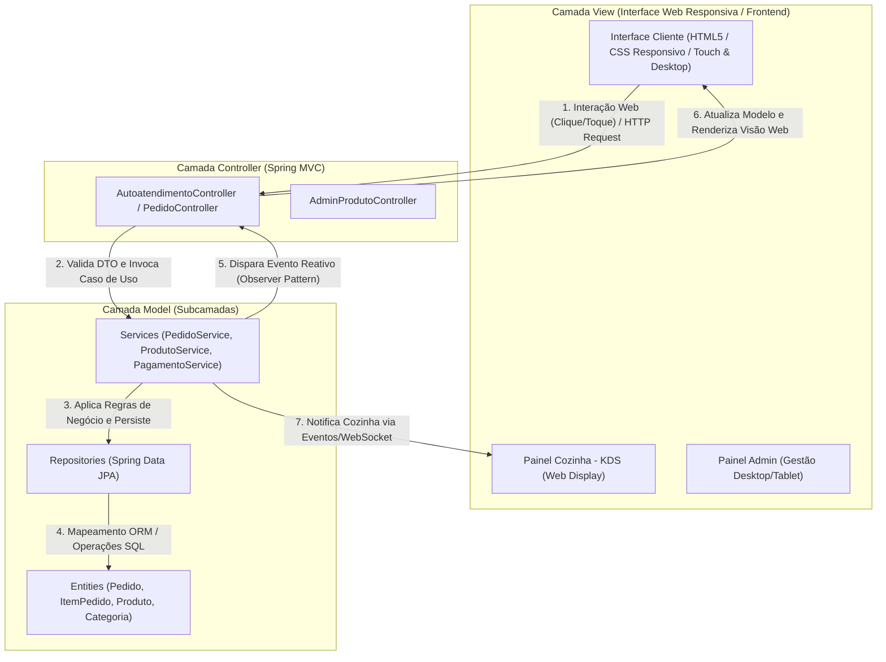
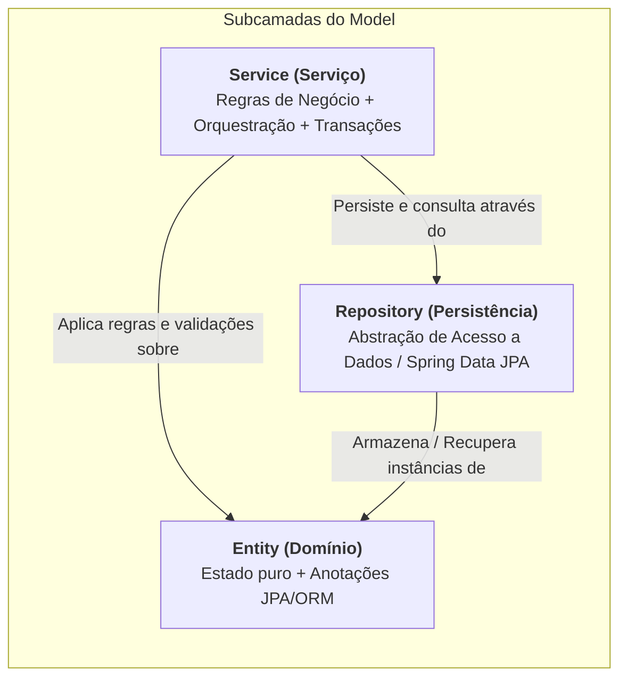
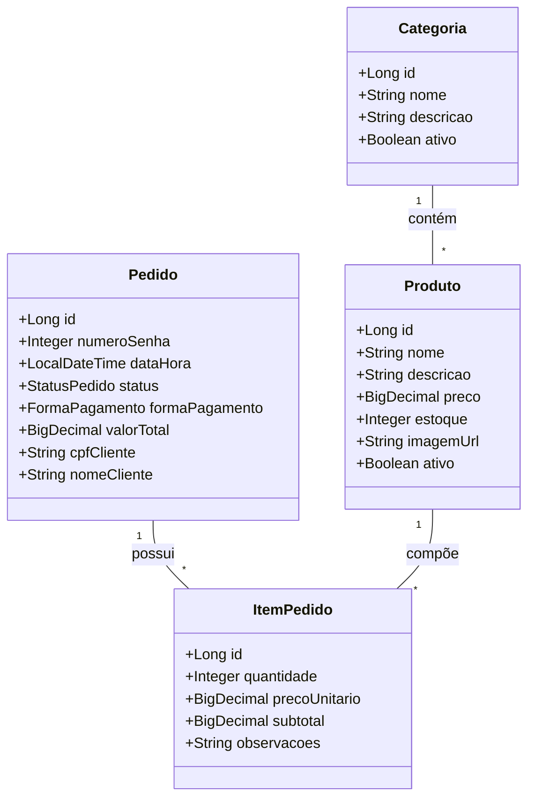
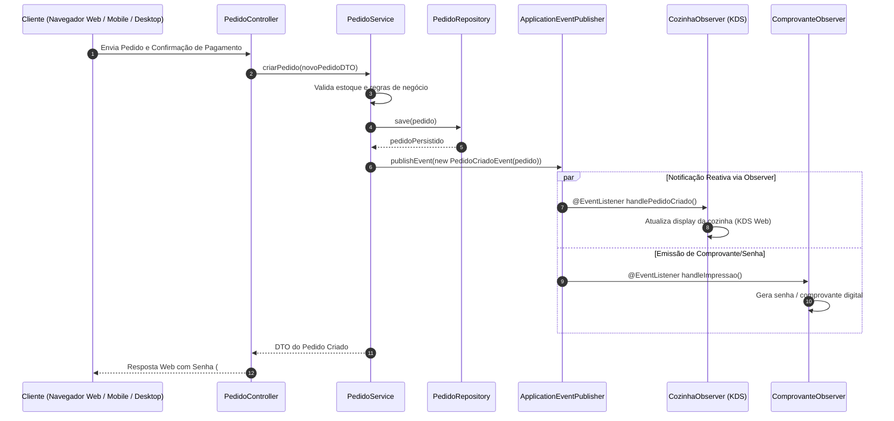
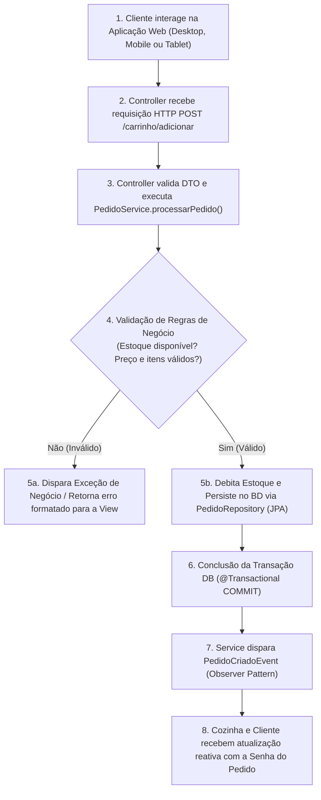

# Especificação Técnica e de Desenvolvimento: Sistema PDV Web Responsivo para Restaurante

---

## 1. Visão Geral do Projeto

O **Sistema PDV Web** é uma solução moderna de Ponto de Venda e Autoatendimento para restaurantes, lanchonetes e estabelecimentos alimentícios. Desenvolvido como uma **aplicação Web responsiva**, o sistema adapta-se perfeitamente a variados tamanhos de tela e dispositivos — desde monitores desktop e terminais de caixa até tablets, smartphones e displays de autoatendimento.

A aplicação possibilita que os clientes naveguem pelo cardápio, personalizem seus pedidos, façam o checkout e efetuem pagamentos (via PIX ou Cartão), além de disponibilizar um painel em tempo real para a cozinha (KDS) e uma área administrativa de gestão.

O desenvolvimento adota o padrão de arquitetura **MVC (Model-View-Controller)** com **Spring Boot**, aplicando rigorosamente as diretrizes de decomposição de camadas (Entity, Service, Repository), persistência de dados via **JPA / Hibernate** e tratamento reativo de eventos com o padrão **Observer**, conforme estabelecido nos conceitos da disciplina.

---

## 2. Requisitos e Funcionalidades

### 2.1 Módulo Autoatendimento & Cliente (Interface Web Responsiva)
1. **Navegação no Cardápio Visível e Responsivo:**
   - Exibição de produtos organizados por **Categorias** (*Lanches, Bebidas, Acompanhamentos, Sobremesas, Combos*).
   - Layout fluido e adaptável a telas Desktop, Tablets e Dispositivos Móveis.
   - Busca e filtragem dinâmica de itens.
2. **Personalização do Pedido:**
   - Adição/Remoção de ingredientes (*ex: "Sem cebola"*, *molho extra*).
   - Seleção de opções, tamanhos e acompanhamentos.
3. **Gestão do Carrinho de Compras:**
   - Adição, alteração de quantidade e remoção de itens.
   - Cálculo dinâmico e em tempo real do valor subtotal e total do pedido.
4. **Identificação do Cliente & Pagamento:**
   - Campo opcional para CPF na nota e nome do cliente para chamada do pedido.
   - Seleção da forma de pagamento: **PIX (QR Code gerado na hora)** ou **Cartão (Crédito/Débito)**.
5. **Emissão de Ficha / Senha:**
   - Conclusão do pedido com geração de número de senha sequencial diária (*ex: `#042`*).
   - Tela de confirmação e disparo automático para o painel da cozinha.

### 2.2 Módulo Cozinha / Operacional (KDS - Kitchen Display System)
1. Painel Web com atualização reativa e em tempo real dos pedidos recebidos.
2. Alteração do fluxo de status do pedido: `RECEBIDO` $\rightarrow$ `EM_PREPARO` $\rightarrow$ `PRONTO` $\rightarrow$ `ENTREGUE`.

### 2.3 Módulo Administrativo / Gestão
1. **CRUD de Produtos e Categorias:** Cadastro, edição, alteração de preço, inclusão de imagens e ativação/desativação de itens no cardápio.
2. **Controle de Estoque:** Baixa automática de ingredientes e produtos ao confirmar venda, com alertas de produto esgotado.
3. **Relatórios de Vendas:** Faturamento diário, itens mais vendidos e distribuição por forma de pagamento.

---

## 3. Arquitetura em Camadas e Padrão MVC

A aplicação segue a divisão em camadas isoladas com responsabilidades bem definidas, eliminando acoplamento direto entre interface e armazenamento de dados.



---

## 4. Desconstrução do Model (Entity, Service e Repository)

Em conformidade com os conceitos da aula, o **Model** é estruturado em 3 subcamadas especializadas:



### 4.1 Entidades de Domínio (`Entity`)
Representam os conceitos de negócio no modelo Orientado a Objetos e espelham a estrutura relacional no banco de dados.

- Contêm atributos privados, getters, setters, construtores e validações no nível da entidade (`@NotNull`, `@Positive`, `@Size`).
- **Mapeamento JPA:**
  - `@Entity`, `@Table(name = "produtos")`
  - `@Id`, `@GeneratedValue(strategy = GenerationType.IDENTITY)`
  - `@Version` para controle de concorrência otimista no estoque.
- **Não contêm lógica de persistência** (evitando o anti-pattern *Active Record* em favor do *Data Mapper*).

### 4.2 Camada de Serviços (`Service`)
O coração das regras de negócio do restaurante.
- **Responsabilidades:**
  - Validar disponibilidade de estoque antes de confirmar o pedido.
  - Validar valores e itens obrigatórios.
  - Orquestrar a transação (`@Transactional` do Spring).
  - Integrar com gateway de pagamento (PIX / Cartão).
  - Disparar eventos do domínio (Observer Pattern) ao alterar status do pedido.

### 4.3 Camada de Repositório (`Repository`)
Aplica o princípio de Inversão de Dependência (DIP - *Dependency Inversion Principle*).
- Interfaces que estendem `JpaRepository<T, ID>` do Spring Data JPA.
- Isolam totalmente o código de regras de negócio das consultas SQL ou detalhes do SGBD (H2 / PostgreSQL).

---

## 5. Mapeamento de Entidades e Persistência ORM (JPA / Hibernate)

### 5.1 Ciclo de Vida das Entidades JPA
No ecossistema Spring Boot / JPA, os objetos transicionam pelos 4 estados do ciclo de vida:

1. **Transient (Transitório):** Objeto recém-criado em memória (`new Pedido()`), ainda não associado ao `EntityManager` e sem ID no banco.
2. **Persistent / Managed (Persistente / Gerenciado):** Objeto associado à sessão JPA ativa. Qualquer alteração em seus atributos será sincronizada automaticamente com o banco no *commit* da transação (Mecanismo de *Dirty Checking*).
3. **Detached (Destacado):** Objeto que já possui ID no banco, mas cuja sessão/transação foi fechada.
4. **Removed (Removido):** Objeto marcado para exclusão no banco de dados após a conclusão da transação.

### 5.2 Mapeamento Objeto-Relacional (DER / Modelo de Dados)



### 5.3 Mapeamento de Código Java com Jakarta Persistence (JPA)

#### Exemplo da Entidade `Produto`:
```java
package com.restaurante.pdv.model.entity;

import jakarta.persistence.*;
import jakarta.validation.constraints.*;
import java.math.BigDecimal;

@Entity
@Table(name = "produtos")
public class Produto {

    @Id
    @GeneratedValue(strategy = GenerationType.IDENTITY)
    private Long id;

    @NotBlank(message = "O nome do produto é obrigatório")
    @Column(nullable = false, length = 100)
    private String nome;

    @Column(length = 255)
    private String descricao;

    @NotNull(message = "O preço é obrigatório")
    @DecimalMin(value = "0.01", message = "O preço deve ser maior que zero")
    @Column(nullable = false, precision = 10, scale = 2)
    private BigDecimal preco;

    @NotNull(message = "A quantidade em estoque é obrigatória")
    @Min(value = 0, message = "O estoque não pode ser negativo")
    @Column(name = "quantidade_estoque", nullable = false)
    private Integer quantidadeEstoque;

    @ManyToOne(fetch = FetchType.LAZY)
    @JoinColumn(name = "categoria_id", nullable = false)
    private Categoria categoria;

    @Column(nullable = false)
    private Boolean ativo = true;

    // Construtores, Getters e Setters
}
```

#### Exemplo da Entidade `Pedido`:
```java
package com.restaurante.pdv.model.entity;

import jakarta.persistence.*;
import java.math.BigDecimal;
import java.time.LocalDateTime;
import java.util.ArrayList;
import java.util.List;

@Entity
@Table(name = "pedidos")
public class Pedido {

    @Id
    @GeneratedValue(strategy = GenerationType.IDENTITY)
    private Long id;

    @Column(name = "numero_senha", nullable = false)
    private Integer numeroSenha;

    @Column(name = "data_hora", nullable = false)
    private LocalDateTime dataHora = LocalDateTime.now();

    @Enumerated(EnumType.STRING)
    @Column(nullable = false, length = 20)
    private StatusPedido status = StatusPedido.RECEBIDO;

    @Enumerated(EnumType.STRING)
    @Column(name = "forma_pagamento", nullable = false, length = 20)
    private FormaPagamento formaPagamento;

    @Column(name = "valor_total", nullable = false, precision = 10, scale = 2)
    private BigDecimal valorTotal = BigDecimal.ZERO;

    @Column(name = "cpf_cliente", length = 14)
    private String cpfCliente;

    @Column(name = "nome_cliente", length = 50)
    private String nomeCliente;

    @OneToMany(mappedBy = "pedido", cascade = CascadeType.ALL, orphanRemoval = true)
    private List<ItemPedido> itens = new ArrayList<>();

    public void adicionarItem(ItemPedido item) {
        itens.add(item);
        item.setPedido(this);
        recalcularTotal();
    }

    public void recalcularTotal() {
        this.valorTotal = itens.stream()
                .map(ItemPedido::getSubtotal)
                .reduce(BigDecimal.ZERO, BigDecimal::add);
    }

    // Getters e Setters
}
```

---

## 6. Padrão Comportamental Observer (GoF / Spring Events)

Para que a alteração de estado no `PedidoService` notifique reativamente telas como o **Painel da Cozinha (KDS)** ou a **Interface do Cliente** sem acoplamento direto entre as visões, utilizaremos o padrão **Observer**, nativamente suportado pelo Spring Boot via `ApplicationEventPublisher` e `@EventListener`.



---

## 7. Fluxo Ponta a Ponta: Da Interação Web à Persistência



---

## 8. Matriz de Responsabilidades e Anti-Patterns a Evitar

| Camada | PODE Fazer | NÃO PODE Fazer (Anti-Patterns) |
|---|---|---|
| **View (UI Web Responsiva)** | Exibir dados e formulários HTML, adaptar layout via CSS/Grid/Flexbox, capturar cliques/toques. | ❌ Executar consultas ao Banco de Dados.<br/>❌ Processar regras de negócio ou cálculo de descontos.<br/>❌ Importar entidades JPA/Hibernate diretamente. |
| **Controller** | Mapear URLs/Rotas HTTP, validar DTOs, invocar Services e retornar Views ou respostas JSON/HTML. | ❌ Ter chamadas diretas ao `EntityManager` ou SQL.<br/>❌ Concentrar regras de negócio complexas (*God Controller*).<br/>❌ Alterar diretamente o banco de dados. |
| **Service (Model)** | Executar regras de negócio, gerenciar transações (`@Transactional`), publicar eventos (*Observer*). | ❌ Depender de pacotes ou classes visuais/Web.<br/>❌ Retornar páginas HTML ou formatação de tela. |
| **Repository (Model)** | Executar operações de acesso a dados (CRUD) e abstrair o SGBD via Spring Data JPA. | ❌ Regras de negócio ou validações de permissão.<br/>❌ Notificações HTTP ou chamadas para o usuário. |
| **Entity (Model)** | Representar modelo de dados e relacionamentos, expor getters/setters e validações de atributos. | ❌ Conter métodos como `salvar()` ou `deletar()` em si própria (*Anemic Model* / *Active Record* inadequado). |

---

## 9. Estrutura do Projeto Spring Boot

```text
projeto-pdv/
├── src/
│   ├── main/
│   │   ├── java/com/restaurante/pdv/
│   │   │   ├── config/              # Configurações do Spring (Security, Web, Eventos)
│   │   │   ├── controller/          # Controllers Spring MVC
│   │   │   │   ├── AutoatendimentoController.java
│   │   │   │   ├── PedidoController.java
│   │   │   │   └── AdminProdutoController.java
│   │   │   ├── dto/                 # Data Transfer Objects (Requisição / Resposta)
│   │   │   │   ├── CarrinhoItemDTO.java
│   │   │   │   ├── NovoPedidoDTO.java
│   │   │   │   └── ProdutoDTO.java
│   │   │   ├── event/               # Eventos e Observers (Observer Pattern)
│   │   │   │   ├── PedidoCriadoEvent.java
│   │   │   │   └── PedidoObserverListener.java
│   │   │   ├── exception/           # Tratamento global de exceções (@ControllerAdvice)
│   │   │   ├── model/               # Subcamadas do Model
│   │   │   │   ├── entity/          # Entidades JPA (@Entity)
│   │   │   │   │   ├── Categoria.java
│   │   │   │   │   ├── Produto.java
│   │   │   │   │   ├── Pedido.java
│   │   │   │   │   ├── ItemPedido.java
│   │   │   │   │   ├── StatusPedido.java
│   │   │   │   │   └── FormaPagamento.java
│   │   │   │   ├── repository/      # Interfaces Spring Data JPA
│   │   │   │   │   ├── ProdutoRepository.java
│   │   │   │   │   ├── CategoriaRepository.java
│   │   │   │   │   └── PedidoRepository.java
│   │   │   │   └── service/         # Regras de Negócio e Transações
│   │   │   │       ├── ProdutoService.java
│   │   │   │       ├── PedidoService.java
│   │   │   │       └── PagamentoService.java
│   │   ├── resources/
│   │   │   ├── templates/           # Visões Responsivas (Thymeleaf / HTML5)
│   │   │   │   ├── cliente/
│   │   │   │   │   ├── cardapio.html
│   │   │   │   │   ├── carrinho.html
│   │   │   │   │   └── confirmacao.html
│   │   │   │   ├── cozinha/
│   │   │   │   │   └── kds.html
│   │   │   │   └── admin/
│   │   │   │       └── produtos.html
│   │   │   ├── static/              # CSS Responsivo, JS, Imagens dos Produtos
│   │   │   └── application.yml      # Configuração H2 / PostgreSQL / JPA
└── pom.xml                          # Gerenciador de Dependências Maven
```

---

## 10. Conclusão

Esta especificação provê o roteiro completo para a implementação do **Sistema PDV Web Responsivo para Restaurantes**, conectando a flexibilidade de acesso web (Desktop, Mobile, Tablets e Kiosks) às boas práticas de arquitetura de software ensinadas na **Aula 08 (Arquitetura MVC e Persistência de Dados)**.
